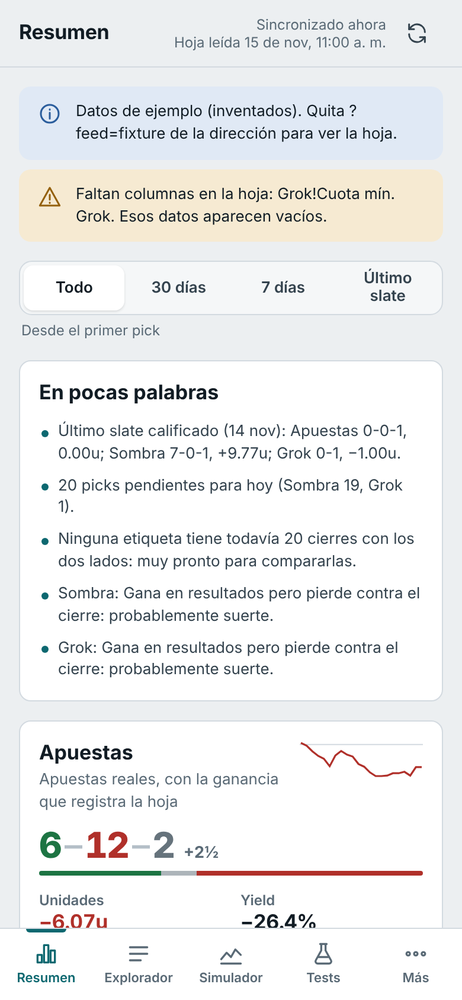
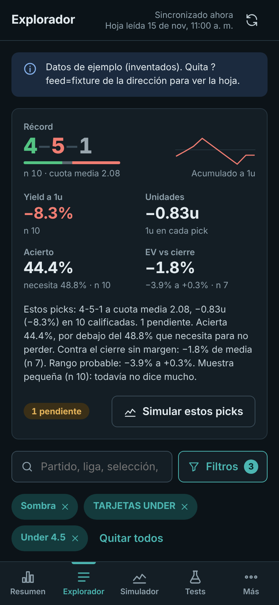
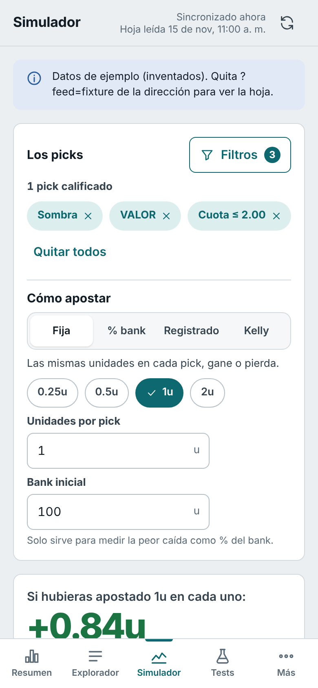
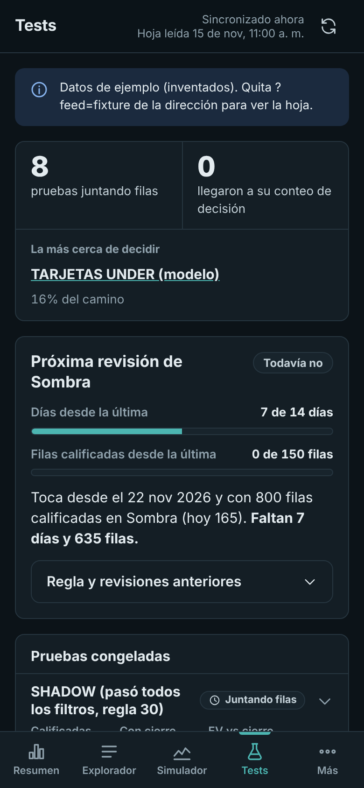
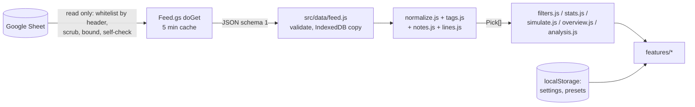

# Bets Tracker

A read-only, installable web app (PWA) over Juan's "Bets Tracker with Claude" Google Sheet: his real
bets, the shadow picks (Sombra), Grok's picks, the frozen tests, the decision log and a glossary, with
filters, a "what if I had bet X on each" simulator and written summaries. Mobile first; Spanish by
default, English complete.

**Live:** https://juansebastianm.github.io/bets-tracker/ (add `?feed=fixture` to see the synthetic
example data instead of the sheet).

The whole app was built in one day (15 Nov 2026) by Claude agents: one orchestrator session and eleven
implementation subagents. [Section 7](#7-how-it-was-built) tells how, step by step, and links every brief.

## Contents

1. [What it is (and is not)](#1-what-it-is-and-is-not)
2. [Features](#2-features)
3. [Architecture](#3-architecture)
4. [Privacy model](#4-privacy-model)
5. [The feed script](#5-the-feed-script)
6. [Running it locally, tests, CI and deploy](#6-running-it-locally-tests-ci-and-deploy)
7. [How it was built](#7-how-it-was-built)
8. [Known limitations and ideas for later](#8-known-limitations-and-ideas-for-later)
9. [Resumen en español](#9-resumen-en-español)

## 1. What it is (and is not)

Juan logs every soccer pick he analyses in a Google Sheet: real bets (`Apuestas`), shadow picks that are
logged without staking (`Sombra`), Grok's picks with Claude's verdict on each (`Grok`), a log of
decisions about the system (`Decisiones`), Pinnacle prices pulled by a script (`Pinnacle`) and the
staking rules (`Reglas`). The sheet stays the source of truth because it is what he uses every day. The
app reads it through a small script inside the sheet and shows it in a way a phone can read: per-tag
results against the closing price, filters by everything that can be filtered, the tests and when they
get decided, and plain-language explanations of every term and rule.

| Overview (light) | Explorer, TARJETAS UNDER + Under 4.5 (dark) | Simulator, VALOR ≤ 2.00 (light) | Tests (dark) |
|---|---|---|---|
|  |  |  |  |

The screenshots are of the synthetic fixture (invented teams, results and notes; the blue banner says
so), at 390 px, taken by `npm run screenshots:readme`.

What it deliberately is **not**:

- **It never writes to the sheet.** The only code that touches the sheet is `apps-script/Feed.gs`, and it
  calls read methods only. Everything the app stores (settings, saved filters, a copy of the feed) stays
  in the browser.
- **It holds no money.** No currency amount, bank balance or unit value is in the feed, the code, the
  fixtures, the docs or the screenshots. The app works in units; a bankroll and a unit value can be typed
  in Settings and stay on that device ([section 4](#4-privacy-model)).
- **It gives no betting advice.** It shows what the sheet recorded and measures it (record, yield, price
  against the close, with sample sizes and ±2 standard errors). The written summaries are built from
  those numbers, say how little a small sample means, and never promise a result.

## 2. Features

Every view is a URL: filters and view options live in the hash query, so a view can be bookmarked,
reloaded or shared. The filter keys are shared by the Explorer, the Simulator and Analysis (see
[State and URL](#state-and-url)).

**Overview** (`#/`, Resumen). A period switch (all, 30 days, 7 days, last graded slate; key `date`) that
applies to the whole screen. Per source (Apuestas with the sheet's own profit, Sombra and Grok at 1u
flat): record as a scoreboard, units, yield, hit rate against break-even (not for real bets, whose
stakes differ), mean **price vs close** ("Precio vs cierre": the taken price × the de-vigged closing
probability − 1) with its ±2 SE range and n, for Sombra also the reviewer's **fair-close EV**
("EV justo (revisión)": the opening at the same source against its close, the headline of the Sombra
reviews) with its n, pending, a sparkline and a paragraph about what the sample can say. "Sombra por
etiqueta": one row per tag with a range bar of price vs close, the review figure under it, and a verdict word chosen by a fixed
rule (`closeVerdict` in `src/data/overview.js`: "sin cierres", "muy pronto" under 20 two-sided closes,
"por encima / por debajo del cierre" when the whole ±2 SE range is on one side, otherwise "tirando a
favor / en contra"); under tags with two or more lines, a collapsed "Por línea" list. The same by
market family. "En pocas palabras" (last slate, pending today, best and worst tag, results vs price),
today's pending picks by slate, "since your last visit" (a small snapshot in this browser), real-bet
extras (units per day, worst drop by day, average stake) and quick links that carry the period. The
rolling periods (7 and 30 days) have no end date, so picks logged for upcoming slates count. Every row
links to exactly the picks it counts, and every link says how many it opens.

**Explorer** (`#/explorer`, `#/explorer/:uid`). Every pick as cards on a phone and a sortable table from
960 px, 50 per page, with a summary strip for the current filter (record, yield at 1u, hit rate vs
break-even, price vs close ±2 SE with n, one sentence, sparkline, "Simular estos picks"). The pick detail
shows everything the sheet and the parsed notes say: sheet row, tag and its meaning, every book's price
and close with the other side, CLV, price vs close and (Sombra) the review's fair-close EV with one-line
explanations, for Grok whose price the quote is and at which book the close was measured, the probabilities,
reference, sample, FUERZA, Pinnacle 1X2 open → last, raw notes, and previous / next inside the filtered
list. Keys: the filter keys plus `sort`, `dir`, `page`.

**The filter panel** (`src/lib/ui/filter-panel.js`, a bottom sheet on phones, a side column from
1200 px): source; tag (grouped: price-first tests, model tests, published, rejects and watch, real bets,
Grok); market family and raw market; **test** (each frozen and price-first test and each stopped category,
by its own membership: the Tests links use it, so they are exact); **line and side** (Over / Under chips and the lines that exist under
the other filters, "Under 4.5 · 11", grouped by kind of market when they mix: TARJETAS UNDER + Under 4.5
is two taps); league (searchable); book; status; price presets (`≤ 1.70`, `1.70–2.00`, `< 2.00`, `≤ 2.00`,
`> 2.00, ≤ 2.50`, `≤ 2.50`, `> 2.50, ≤ 4.00`, `≤ 4.00`, `> 4.00`, each label built from its bounds) or a
custom min/max; date presets (last graded slate, newest slate with pending picks, 7 days, 30 days, this month
— the rolling ones with no end date —, since a date; the panel says the dates), a from/to range and
one slate date; has a closing price; has a two-sided close; reference; sample; FUERZA; filter reason and
"passed every filter"; logged EV range; model probability range; free text. Every option shows how many
picks it would give with the other filters as they are; options at zero are disabled or hidden. Saved
filters (with a name, in this browser) and built-in starting points.

**Simulator** (`#/simulator`). "Si hubieras apostado 1u en cada uno: +x.xxu" for any filtered set, with
four staking modes: flat units, % of the bankroll (compounding, same-day picks staked on the day's
starting bankroll), "as staked" (the sheet's stake and profit for real bets, Grok's suggested stake),
and fractional Kelly from the logged fair probability with a cap. Record, yield, the chance range (±2 SE
of the summed profit), the cumulative curve with drawdown shading and the "expected by the close" line
(Σ stake × price vs close), worst drop, streaks, best and worst day, time under water, month by month,
breakdown by tag / market / price band / line with exact links to the Explorer, pending stakes, a
scenario B on the same chart and saved scenarios. Money appears only when a unit value is set in
Settings. Keys: the filter keys plus `mode`, `stake`, `pct`, `bank`, `kf`, `kcap`, and `b` (scenario B's
own query string).

**Tests** (`#/tests`). An overview strip, the next Sombra review (14 days and 150 graded rows since the
last "Revisión Sombra" decision) with two meters and past reviews, then one compact row per test that
expands in place: the frozen model tests (graded out of 100, two-sided closes out of 50, mean price
against the close with ±2 SE drawn against zero, the state and the rule in words, flat results marked
"context, decides nothing", a projected decision date) and the price-first tests (VALOR, VALOR CASI,
VALOR PROP, VALOR PROP CASI) with their own rules. Stopped categories sit in one disclosure. Every card
links to exactly its rows in the Explorer ("Ver las 34 filas en el Explorador", filter key `test`, pending
rows included, the same count the Explorer shows). Key: `open` (the expanded test).

**Analysis** (`#/analysis/:part`, parts `breakdown`, `calibration`, `close`, `grok`). Breakdown by 16
dimensions (tag, market, raw market, league, book, price band, month, weekday, model-probability band,
logged-EV band, reference, sample, FUERZA, reason, source, line) with n, record, hit rate vs break-even,
yield ±2 SE, price vs close ±2 SE and the verdict word; a range chart; a minimum-n slider; an optional
second dimension; every row links to exactly its picks in the Explorer (or has no link when that is
impossible, e.g. weekday). Calibration of the model, blend, consensus and Sofascore AI probabilities
with Brier scores beside the market's. Price against the close: histogram, share above zero, raw CLV as
context, split by close source, closing moves by market, Pinnacle 1X2 direction. Grok vs Claude: Grok's
picks by our verdict and reason, his team corners against Sombra's CÓRNERS EQUIPO, by market, and a
written comparison that states n. Keys: the filter keys plus `dim`, `dim2`, `sort`, `dir`, `measure`,
`minn`, `small`, `series`.

**Decisions** (`#/decisions`, `#/decisions/:row`). The Decisiones tab as a timeline grouped by month, 25
per page, with the sheet's status word on a chip that differs by icon and border too, a derived theme,
search over every column (accent-insensitive, highlighted, opens the evidence when the match is there),
filters by status, theme and dates, an "in force" view, one page per decision with what it cites and what
cites it, and the staking rules of the Reglas tab linked to their glossary entries. "fila 110" and "regla
29" inside any text become links through a tokenizer (never HTML). Keys: `q`, `st`, `th`, `from`, `to`,
`view`, `page`.

**Glossary** (`#/glossary`, `#/glossary/:slug`). 143 entries in nine categories (betting basics, markets,
the system, every sheet tag, note abbreviations, filters and reasons, statuses, review measures,
sources) and the 36 betting-analyst rules in plain words (`rule-1` … `rule-36`), each with a one-sentence
"En corto" first. Search as you type, collapsed category groups on phones, deep links; terms are linked
inline elsewhere in the app. Content in `src/content/{glossary,rules}.{es,en}.json`. Keys: `tab`
(`rules`), `q`, `cat`, `state`.

**Settings** (`#/settings`, also reachable from "Más" on phones). Language, theme (auto, light, dark),
bankroll, unit value and currency label (on this device only), default simulator stake, saved filters,
feed status (source, last sync, "sheet read at", rows per tab, redactions, missing columns, and whether
the sheet runs the feed script version this app expects, with what to do when not), app status
and update button, version and schema.

## 3. Architecture

### Stack, and why there is no build step

- **Preact + htm**, plain ES modules loaded by the browser as they are. Libraries are bundled once by the
  `vendor` GitHub workflow from `vendor/versions.json` (preact 10.29.8, htm 3.1.1) and committed to
  `/vendor`. No CDN at run time.
- **TypeScript as a checker only**: `.js` with JSDoc types, `tsc --noEmit` in `npm run check`.
- **Hand-written SVG charts** (`src/lib/charts`): line, multi-line, bars, range, histogram, calibration,
  sparkline; each one measures its box and has a text summary and a table toggle.
- **Tests**: `node --test` and Playwright. **Hosting**: GitHub Pages from `main` after CI passes.
- **Feed**: a Google Apps Script web app inside the sheet ([section 5](#5-the-feed-script)).

There is no bundler because the agents' workspace has no npm registry and no CDN: only a fixed set of
preinstalled tools (TypeScript, Playwright). Everything had to run from the files as written, so the
app is the files: what is in `src/` is what the browser runs, and the deploy only copies files and
stamps a version. The same shape had been used in an earlier project of Juan's.

### Repository layout

```
index.html, manifest.webmanifest, sw.js   app shell, PWA manifest, service worker (shell only)
apps-script/Feed.gs                       the only code that reads the sheet
src/main.js, src/app.js, src/config.js    boot, router and layout, FEED_URL and schema
src/data/        the data layer: feed, normalize, tags, notes, lines, filters, stats, simulate,
                 summaries, overview, analysis, explore, decisions, content, tests-config, settings, store
src/lib/         ui/ (kit and filter panel), charts/, format, i18n, router, storage, pwa, glossary-links, links
src/features/    one folder per section: overview, explorer, simulator, tests, analysis, decisions,
                 glossary, settings (+ registry.js)
src/i18n/, src/content/   shared strings (es, en); glossary and rules content
src/styles/      tokens.css (light and dark), base.css, components.css, filter-panel.css
scripts/         serve, build-site, check-i18n, make-fixture, make-icons, vendor-build, bin
tests/unit/, tests/e2e/, tests/fixtures/  39 unit test files, 21 e2e specs (4 of them screenshots), the synthetic feed
docs/            ARCHITECTURE, DATA_CONTRACT, FEATURE_GUIDE, BUILD_LOG, briefs/, screenshots/
```

### Data flow



On start the app shows the IndexedDB copy at once, fetches the live feed (`credentials: 'omit'`) and swaps
it in; a failed fetch never drops data already shown. The header always shows "last synced" and "sheet
read at" (`generatedAt`). A feed with a newer schema is refused with a message instead of misread.

### The unified pick model

`normalize.js` turns Apuestas, Sombra and Grok into one `Pick[]` (`src/data/types.d.ts`; the contract,
section 4): source, sheet row, match date, league, match, raw and normalized market (`result`, `goals`,
`corners_total`, `corners_team`, `cards_total`, `cards_team`, `shots`, `combo`, `other`), review class,
selection, line and `lineKey` (`cards:under:4.5`, `ah:+0.25`), side, price, close, status, tag, books,
stake and profit (real bets), probabilities, logged EV, raw CLV at the same source, price vs close
(`fairCloseEv`: price × de-vigged close − 1, own book first, else the bet365 feed; the frozen tests'
measure), the reviewer's fair-close EV (`openingFairEv`: the opening at the same source × its de-vigged
close − 1; the Sombra reviews' headline and the VALOR tests' measure), and `parsed`, the notes read into
fields. Every screen works on this array.

### Tags and parsed notes

A Sombra row's tag comes from the start of `Motivo de descarte`, first match wins, in `review.py`'s
order (`src/data/tags.js`): PUBLICADA Y APOSTADA, PUBLICADA NO APOSTADA, VALOR PROP CASI, VALOR PROP,
VALOR CASI, VALOR, TARJETAS UNDER, CÓRNERS EQUIPO, CÓRNERS RECHAZO, MODELO SOLO, SHADOW (regla 30),
SHADOW, IA-WATCH, low edge, filter reject. Ids are English (`near_value`); the screen shows the sheet's
own label. `notes.js` reads the note formats of the betting-analyst skill: feed price and opening,
reference, sample, FUERZA, Pinnacle ids, the bet365 close with the other side, each book's price and
close from clv-logger, logged CLV and EV, the price source, and the filter reasons. The rules were ported
from `review.py`, the script Juan's reviews run, and checked against it by the audit.

### Where each formula lives

| Number | Place |
|---|---|
| flat profit, yield, hit rate, break-even, means with SE clustered by match, drawdown, streaks, calibration, Brier, price bands | `src/data/stats.js` |
| staking modes, Kelly, expected by the close, chance range, time under water | `src/data/simulate.js` |
| frozen-test and price-first memberships, progress, projections, review schedule | `src/data/tests-config.js` |
| verdict word, period, per-tag and per-market rows, last visit | `src/data/overview.js` |
| breakdown dimensions, exact row links, close moves, Pinnacle direction, Grok verdicts | `src/data/analysis.js` |
| lines and their labels | `src/data/lines.js` |
| filter state, presets, facet counts, URL round trip | `src/data/filters.js` |

Screens format numbers (`src/lib/format.js`) and never compute them. The deliberate differences from
`review.py` are listed in `docs/DATA_CONTRACT.md` section 7.

### State and URL

Hash routes (`#/explorer/shadow:412?tag=value`). The filter state is one plain object
(`src/data/filters.js`) serialised to the query: `src, tag, mkt, mraw, lg, book, st, ref, sample, fz,
why, side, line, test` (lists), `price` (preset) or `pmin`/`pmax`, `date`, `from`, `to`, `slate`, `close`,
`close2`, `evmin`/`evmax`, `prmin`/`prmax`, `pass`, `q`. Settings and saved filters are in `localStorage`
(`bt.*`); the feed copy in IndexedDB. Derived stats are memoised on the dataset version and the query.
A 5,000-pick test (`tests/unit/polish-perf.test.mjs`) holds normalize, a filter change with every facet
count, the Overview, Analysis and Simulator figures to time budgets.

### Offline

The service worker caches the app shell only: the deploy (`scripts/build-site.mjs`) lists every file
under `src/` in its precache and stamps it with the commit, fetching each file with a cache-busting
query so a CDN copy of the previous deploy cannot be pinned. The feed is never cached by the service
worker (it is on another origin); the app keeps its own copy in IndexedDB, so every route opens offline
with the last data and a banner. `tests/e2e/polish-offline.spec.js` builds the site, serves it under a
non-localhost name (the service worker is off on localhost), cuts the network and opens every route.
Settings shows whether a new version waits, with a reload button.

### i18n, theming, accessibility

- Every visible string goes through `t()`: Spanish (natural Colombian Spanish, tú) by default, English
  complete; `scripts/check-i18n.mjs` fails on a key missing in either language or a `t()` key that does
  not exist. Sheet text (leagues, matches, notes, decisions, tags) is shown as written, never translated.
- Theme tokens in `src/styles/tokens.css` for light and dark; the user picks auto, light or dark, applied
  before first paint by `src/lib/theme-boot.js`. One accent (floodlight teal); green and red only for
  results, amber only for pending.
- 44 px targets, visible focus, labels on every control, charts with a summary sentence and a table,
  colour never the only signal (won / lost also differ by icon or sign), no horizontal page scroll at
  390 px (checked by the e2e), reduced motion respected. Screen readers were not tried with a real
  reader; roles, names and focus order are checked by the tests.

## 4. Privacy model

The repository is public and the feed URL is public by design. The rule is simple: **no money leaves
the sheet**, and the app holds no sheet data in the repository.

**What never leaves the sheet:** the tabs `Bank`, `Resumen mensual`, `Por mercado` and `Por liga` (never
opened); the money columns of Apuestas (`Stake (COP)`, `Ganancia (COP)`, `Bank acumulado (COP)`, never
read); the block above the `Reglas` header and rule 1, which states the unit value (only the numbered
lines after rule 1 are published); every column not on the whitelist.

**How it is enforced** (`apps-script/Feed.gs`; rules in `docs/DATA_CONTRACT.md` section 2):

1. **Whitelist by header.** Each tab lists the headers it may read (`BT_FEED_TABS`); columns are found by
   header text, never by position, so a moved or new column cannot leak or shift data. A whitelisted
   header that appears twice is read from neither copy and reported.
2. **Refused headers.** A header containing `COP`, `bank` or `$` is refused even if someone adds it to the
   whitelist.
3. **Scrubbing.** Every text cell is scrubbed: a dollar or other currency sign next to a number; numbers
   with `COP`, `pesos`, `euros`, `USD` and friends before or after (with `mil`, `k`, `M`, `millones`,
   `palos`, `lucas`); numbers with two or more thousand groups; thousands written with spaces; a
   money-sized number within 25 characters after a money word (`bank`, `saldo`, `freebet`, `unidad`,
   `1u =`, `aposté`…); bare integers of five or more digits. Hits become `[oculto]` and are counted in
   `meta.redactions`. Counts of things (`60 mil caracteres`) and three-decimal prices stay.
4. **Numeric bounds.** A number above a plausible bound for its kind (price or units above 1,000, a
   probability above 1…) is dropped and counted, so money typed into a units column cannot pass as a
   number. A numeric cell holding money text becomes empty.
5. **Self-check.** After the JSON is built the script searches every string once more for `COP` or a
   currency sign next to a number; a hit replaces the whole cell and is counted.
6. **Privacy tests.** `tests/unit/privacy.test.mjs` and `tests/unit/audit-feed.test.mjs` run the real
   scrubber on a fixture with money in every shape above (made up), check the exact output, check that
   money headers are refused, and grep the whole repository for money patterns. `npm run check` fails
   on any hit; the test must never be weakened to pass.
7. **CSP.** `index.html` allows scripts, styles and fonts only from the app's own origin and network
   requests only to the app and `script.google.com` / `script.googleusercontent.com`. There are no
   analytics and no third-party requests.

**The bankroll setting.** Settings has optional fields for a bankroll, the value of one unit and a
currency label. They exist so Juan can see money on his own phone and try the Simulator with different
bankrolls, and so nobody else who opens the link sees his real bankroll. They are saved in that
browser's `localStorage` (`bt.settings`), never sent anywhere, and can be cleared with one button.

**What someone with the public feed URL can and cannot do.** They can read the same whitelisted, scrubbed
JSON the app reads: picks, results, units, notes, decisions. They cannot write anything (the script has no
write path and ignores every request parameter), cannot read another column or tab, and cannot bypass
the cache: `doGet` answers from a 5-minute `CacheService` copy, and a script lock lets one call rebuild it
while the others wait, so a burst of requests reads the sheet about once per 5 minutes. Calls still run
under the owner's Apps Script quota (about 30 simultaneous executions and a daily runtime); if the URL
is ever abused, the kill switch is to archive the deployment ([section 5](#5-the-feed-script)).

**Known limits, plainly:**

- Scrubbing is best effort. An amount written only in words ("cuarenta mil pesos") or a single thousand
  group with no money word near it ("80.000 en Betano") would pass. The durable fix is not to write
  balances in notes.
- Units are public by design. `Stake máx. (u)` is ¼ Kelly × the bank in units, so a reader can estimate
  the bank **in units**, never in money.
- The feed shows team names, leagues and Juan's notes; it is not anonymous.
- Git history keeps earlier copies of about twenty real `Motivo de descarte` reason texts and a few real
  staking-rule lines that were in the unit tests and the fixture generator until the docs pass replaced
  them with invented text; no money and no match names were in them.
- Some agents' read-only reads of the `Reglas` tab started at row 8, which includes rule 1 (the unit value
  line); nothing from it was copied anywhere, and the allowed range is now row 10 (the published briefs
  in `docs/briefs/` say so).

## 5. The feed script

`apps-script/Feed.gs` is one file with a pure core and a thin Apps Script shell. `btFeedBuild(tabValues,
timeZone, now)` takes plain 2-D arrays and returns the feed object, so the unit tests load the same file in
Node with `node:vm` (`tests/unit/helpers/feed-gs.mjs`) with no Apps Script at all. The Apps Script part
is a few read calls (`getSheetByName`, `getDataRange`, `getValues`, `getSpreadsheetTimeZone`), the cache
and the lock.

**How it was installed.** The sheet already had an Apps Script project holding Juan's Pinnacle odds
puller (`Code.gs`, run by a time trigger every 15 minutes). `Feed.gs` was added to that project as a
second file through Juan's browser, without touching `Code.gs`: the file was loaded from this repository
at a pinned commit and its SHA-256 compared in the page before saving. Every global starts with `btFeed`
or `BT_FEED_` so nothing collides; the only unprefixed name is `doGet`, which a web app needs. It was
deployed as a web app, "execute as me, anyone with the link", and its `/exec` URL is `FEED_URL` in
`src/config.js`.

**Why there is no scope annotation.** The usual `@OnlyCurrentDoc` annotation was removed before
installing (commit `3e89427`). The project had been authorised with the full spreadsheet scope by the
Pinnacle script; an annotation in a new file narrows the scopes of the whole project, which could have
stopped the Pinnacle trigger until someone re-authorised it. The feed needs nothing beyond what was
already granted. The next trigger run after the install completed normally.

**Self-test.** In the editor, choose `btFeedSelfTest` and run it. The log shows the script version,
rows per tab, `meta.redactions`, `meta.missingHeaders` (should be `[]`), the JSON size, and "money marker
left: no". Run it before every deploy.

**Script version.** `BT_FEED_SCRIPT_VERSION` is derived from the file's own content (the first 12 hex
characters of its SHA-256 with that value blanked). After any edit to `Feed.gs`, run `npm run feed:stamp`:
it writes the new value into `Feed.gs`, `src/feed-version.js` (the version the app expects) and the
fixture; `npm run check` fails until you do. The feed returns it as `meta.scriptVersion`, and the cache keys
carry it. Settings → "Datos de la hoja" shows the version in the sheet, the version the app expects and
whether they match; when they do not (or the sheet's script is older than the field), a calm banner on the
Overview and Settings says so. The data keeps showing either way.

**Redeploy after a change.** Paste the new file over `Feed.gs`, run `btFeedSelfTest`, then Implementar →
Gestionar implementaciones → the existing deployment → edit → Versión: "Nueva versión" → Implementar.
The `/exec` URL stays the same. Bump `BT_FEED_SCHEMA` (and the app's `FEED_SCHEMA`) only when the JSON
shape changes. Run `btFeedClearCache` to drop the 5-minute cache at once. Then check Settings → "Datos de
la hoja": after a refresh the script version should say it is up to date (without `btFeedClearCache` the
old cached response can take up to 5 minutes to turn over).

**Rotate the URL (kill switch).** Implementar → Gestionar implementaciones → archive the deployment (the
URL stops working at once) → Nueva implementación with the same settings → put the new `/exec` URL in
`src/config.js` → push. CI deploys the app with the new URL; installed apps show their cached copy
until then.

## 6. Running it locally, tests, CI and deploy

Node 22 or later; no install needed to run the app.

```sh
npm run dev                         # http://127.0.0.1:5173/?feed=fixture  (synthetic data)
npm run check                       # typecheck + unit tests (privacy included) + i18n parity + e2e
npm test                            # unit tests only
npm run test:e2e -- tests/e2e/explorer.spec.js
npm run fixture                     # regenerate tests/fixtures/feed.json (deterministic)
SCREENSHOT_DIR=/tmp/shots npm run screenshots   # every route: phone and desktop, light and dark
npm run screenshots:readme          # the four images in docs/screenshots/
```

- **Tests.** At the time of writing (19 Nov 2026): 285 unit tests in 39 files (`node --test`) and 190
  Playwright tests in 17 specs, 8 of them skipped by design (a 390 px phone by default; wide-screen
  tests set their viewport); `npm run check` runs them all in about 4 minutes. E2E runs on the fixture
  only and never calls the real script; a test that needs "today" fixes the browser clock. Set
  `E2E_PORT` when several checkouts run at once: the config reuses any server on the port.
- **The fixture.** `scripts/make-fixture.mjs` writes `tests/fixtures/feed.json` from a seeded random
  generator: 247 picks with invented teams, leagues, reasons and notes in the real formats, ~106% books so
  a fair-close EV is never larger than its raw CLV, and every edge case a test needs. It is never real
  data. `?feed=fixture` loads it in the browser.
- **CI and deploy** (`.github/workflows/ci.yml`). Every push runs `npm run check` (CI installs the exact
  tool versions and Chromium). On `main`, when it passes, `scripts/build-site.mjs` assembles `_site`, stamps
  `sw.js` and `src/version.js` with the commit, deploys to GitHub Pages, and a smoke step waits for the new
  `sw.js`, checks the version and fetches a list of files from the live site.
- **Vendor workflow** (`.github/workflows/vendor.yml`). Edit `vendor/versions.json` and push to `main`: the
  workflow installs the pinned packages and esbuild, bundles them with `scripts/vendor-build.mjs`,
  smoke-tests the exports and commits `/vendor`.
- **The agent workspace.** The workspace where the agents worked has no npm registry and no CDN.
  `scripts/bin.mjs` links `node_modules` to preinstalled tools in `/opt/npm-tools/node_modules` and runs
  them; local Playwright uses the system Chrome. Never run `npm install` there.

## 7. How it was built

### The request

On 15 Nov 2026 Juan asked for "a PWA app that displays all the data in my 'Bets Tracker with Claude'
Google Sheet in a nice way": how Sombra, Grok and Apuestas are doing; filters by market, price ranges
(≤2.0, <2.0, ≤2.5…), tags (VALOR, VALOR CASI, TARJETAS UNDER, SHADOW…) and slate dates; summaries in
human-readable text; read only, never edit; a section "if you had placed these bets at 1u each, this is
how they would look now" with filters, unit amount and price ranges; a glossary of betting terms and the
sheet's own; and every rule of his betting-analyst skill "in easily digestible words". He added that the
README "must include all details about how the app was built".

### Juan's decisions

Asked before any code was written (morning of 15 Nov, before the first commit at 11:56 Bogotá time):

- **The sheet stays the source of truth**, because it is what he uses every day; the app only reads it.
- **Data feed: a script inside the sheet** (an Apps Script web app), installed by Claude through his
  Chrome, rather than a database or a sync job.
- **Access: anyone with the link** (no passcode). The repository `JuanSebastianM/bets-tracker` is public,
  created by Claude through his browser.
- **Spanish with an English toggle.**
- **No bank balance in the app**: the bankroll is typed by hand in the app, to simulate with different
  bankrolls and so other people who open the page do not see his.
- **All code in English** (commit `1d4e74b` at 11:58 changed the contract right after he said it).
- **Cache and kill switch** (during the foundation, before 12:25): he asked whether the public URL could be
  abused with mass calls; the answer was a short response cache in the script plus archiving the
  deployment for a new URL.
- **Line filters** (after the Explorer was live, about 14:40): "Is it possible to also filter by specific
  lines? Like TARJETAS UNDER 4.5, tarjetas under 5.5, etc? Same for all other tags where possible."

### The orchestration model

One **orchestrator** session (Claude Fable 5.2) planned the work, wrote the contracts, wrote one brief per
task, reviewed every hand-off and its screenshots, sent work back, merged the branches into `main`,
installed the feed script in the sheet through Juan's browser and deployed. **Implementation** was
delegated to subagents running **Claude Opus 5.5 at medium effort**, as Juan asked. Each subagent worked
in its own git worktree on its own `feat/<id>` branch with its own Playwright port, so several could run
at once without testing each other's files; none could push or touch `main`. Each one read the contracts
first, worked only in the files it owned (shared files only by adding, listed in its hand-off), ran
`npm run check`, looked at its own screenshots, wrote a build-log entry and reported back with exact test
counts and what it could not verify.

### Contracts before code (11:56 to 11:58)

The first commit (`f6f7fce`) holds no code: `docs/ARCHITECTURE.md` (stack, layout, sections, routes,
conventions), `docs/DATA_CONTRACT.md` (the feed JSON, the whitelist, the privacy rules, the `Pick` model,
the tags, the note formats, the formulas) and `CLAUDE.md` (the rules that are easy to get wrong). Every
later brief points to them, and the agents corrected them when the real data disagreed.

### Step by step

All times are Bogotá time on 15 Nov 2026. The briefs are published in [`docs/briefs/`](docs/briefs/)
(spreadsheet ID and local paths replaced by placeholders, the commit attribution address and session link
replaced too, the Reglas range set to row 10, and one money-shaped example in the audit brief reworded
for the privacy test; [`common.md`](docs/briefs/common.md) is the
shared setup and rules block every brief ends with). Each agent's own account is in
[`docs/BUILD_LOG.md`](docs/BUILD_LOG.md).

1. **Foundation** (11:58 to 12:43; no separate brief file was kept). One agent built the feed script, the
   whole data layer, the shell, UI kit, charts, tokens, i18n, Settings, a stub for every section, the
   PWA, the deterministic fixture, 72 unit and 21 e2e tests, and the CI, Pages and vendor workflows.
   Before writing parsers it read the real sheet with targeted read-only calls (headers, every status,
   all 710 Sombra reasons, notes, verdicts, market values) and copied nothing; that found, among other
   things, that the sheet writes "Medio ganada", not "Media", and that its time zone is not Bogotá.
   `review.py` from the betting-review skill became the reference for every number.
2. **Feed installed** (12:43 to 13:12, orchestrator). The scope annotation was removed (`3e89427`, see
   section 5), the script installed beside the Pinnacle puller and self-tested, the web app deployed and
   its URL connected (`43e277b`). The first look at the live feed found a bug: the final self-check
   treated any dollar sign as money and hid a whole decision whose evidence only quotes a `$(…)` template
   placeholder; the check now needs a number next to the sign.
3. **Overview, Explorer and Tests in parallel** ([overview](docs/briefs/overview.md),
   [explorer](docs/briefs/explorer.md), [tests](docs/briefs/tests.md); merged 14:00, 14:09, 14:14).
   Overview: per-source cards, the per-tag table with the verdict rule, summaries, pending, last visit.
   Explorer: the shared filter panel, the list, the table, the pick detail, saved filters. Tests: the
   frozen and price-first tests ported line by line from `review.py`. **Sent back:** the Tests screen was
   about 25,500 px tall on a phone, roughly 30 screens of one big card per test; the revision turned it
   into one compact row per test with an accordion (about 2,400 px). That lesson ("compact rows that
   expand") went into every later brief.
4. **Decisions and Glossary, then Simulator** ([knowledge](docs/briefs/knowledge.md),
   [simulator](docs/briefs/simulator.md); merged 14:24, 14:30). Knowledge: the timeline, the safe
   cross-reference tokenizer, 143 glossary entries and the 36 rules in plain words in two languages.
   Simulator: four staking modes, the expected-by-close line (a new `MultiLineChart`), scenario B, saved
   scenarios.
5. **Analysis** ([analysis](docs/briefs/analysis.md); merged 14:39). Breakdowns, calibration, the close,
   Grok vs Claude, with a `RangeChart` and a `Histogram` added to the charts module. The Simulator had
   extended the same file on its own branch, so the merge (`7a50dea`) had conflicts in
   `src/lib/charts/index.js`, resolved by hand by the orchestrator keeping both sets of charts. The agent
   could not write its build-log file; the orchestrator wrote it from the hand-off. A race in its minimum-n e2e test (counting before the list had rendered) made CI flaky and
   was fixed right after (`90d6bcb`).
6. **Line filters** ([lines](docs/briefs/lines.md); merged 14:50), Juan's mid-day request: line and side
   parsed for every pick, the "Línea" panel section, breakdown by line, exact Tests links, and a boundary
   fix: a pick priced exactly 1.70 had been counted in two price slices, so bands became disjoint and
   every breakdown link now selects exactly the row's picks.
7. **Independent audit and polish in parallel** ([audit](docs/briefs/audit.md),
   [polish](docs/briefs/polish.md); merged 15:20, 15:33). The auditor had built nothing; it read the
   allowed ranges of the real sheet into a temporary folder outside the repository, ran the real script
   core and the app's data layer on it, ran `review.py` on the same rows and its own recomputation, and
   checked 101 filter combinations and the Simulator by hand. **Found:** the scrubber missed many money
   shapes (millions in words, `M` suffixes, `mil` without a currency, spaced thousands, other currencies,
   money-sized numbers after money words); numeric cells had no plausibility bound; a duplicated header
   was read from its first copy; four early Grok verdict shapes were unclassified. All fixed with
   synthetic tests; on the real sheet the extended scrubber hid one more cell part than before. The
   numbers matched `review.py` apart from the documented differences. Its remaining small findings (real
   reason text in tests, price labels, two undocumented differences, stale counts, the Reglas range)
   were closed in the docs pass. **Polish** made it one app: one source for glossary links and every slug
   checked, a one-sentence "En corto" for each rule, inline term links, shared helpers instead of copies,
   full-height rail and sticky table heads, the 5,000-pick speed test (note parsing compiled its regular
   expressions once instead of per row: normalize roughly 360 → 110–250 ms), the Glossary (≈16,000 →
   ≈920 px) and Decisions made comfortable on a phone, offline e2e on the built site, manifest shortcuts
   and the update flow, and the docs brought in line with the code. **After the merges** the orchestrator
   pasted the hardened `Feed.gs` into the sheet (same pinned-commit and hash check as the first install),
   ran the self-test on the real sheet, redeployed it as version 3 at the same URL and checked the live
   feed from the app's origin for every money shape. The polish merge then failed CI twice over
   (`549fae9`) while passing locally: the runner's wider fallback font made the 248 px filter column
   overflow, and the runner's Chromium ignored the launch flags the offline test used to get a service
   worker on a made-up host. Both were fixed in `1aa0c3c` (every grid in the panel got a shrinkable
   column, and the test now also runs with a wider font; the offline test uses the app's own `?sw=on`
   override on 127.0.0.1), and the next run deployed. The live site was then smoke-tested on the real
   data from Juan's browser: every route, no errors, no horizontal scroll, no money on screen.
8. **Docs** ([docs](docs/briefs/docs.md)): the last audit findings (invented text instead of real reason
   and rule strings, price labels derived from their bounds, the documented `review.py` differences),
   this README, the published briefs and one build log.

### Numbers

- 11 implementation subagents (foundation, overview, tests, explorer, decisions and glossary, simulator,
  analysis, line filters, audit, polish, docs) and one orchestrator session.
- About 4 hours from the first commit (11:56) to the polish merge (15:33). At the polish merge `main` had
  50 commits: 40 by the agents and the orchestrator, 9 merges by the orchestrator and 1 by the vendor
  workflow; about 30,900
  lines added across 205 files.
- Tests at the time of writing: 242 unit, 119 end-to-end.
- Approximate subagent tokens: foundation 596k, overview 244k, tests 382k, explorer 309k, decisions and
  glossary 443k, simulator 278k, analysis 391k, line filters 310k, audit 398k, polish 474k (3.8M in
  total), plus the docs pass (an estimate of a few hundred thousand; it did not measure its own use). The
  orchestrator's own use is not included.

### What went wrong, and what was learned

- **Too tall on a phone.** The first Tests screen was 30 phone screens long; Glossary and Decisions later
  reached 16,000 and 8,000 px with real data. Lesson: design for the real volume, not the fixture, and
  default to compact rows that expand.
- **Parallel branches on shared files.** The Simulator and Analysis branches extending the charts module
  at once meant hand-resolved conflicts. "Shared files only by adding, listed in the hand-off" kept the rest clean.
- **A flaky test is a bug.** One e2e counted rows before the list rendered and failed only on CI. Tests
  now wait on conditions, never on time; CI retries once only to report flakiness and still fails.
- **The scope annotation.** The standard advice (narrow the script's scopes) would have silently stopped
  another script's trigger in the same project. Check what else lives in a shared Apps Script project.
- **A false positive can hide real data.** The money self-check hid a whole decision because of a `$(…)`
  placeholder. Privacy checks need tests for what must stay readable as much as for what must go.
- **The fixture is not the sheet.** The synthetic data missed real shapes (verdicts, decision topics,
  rule lines, money written in words). Short, targeted read-only checks on the real sheet and an
  independent audit caught them; the fixture must still never hold real text, which is why the docs
  pass rewrote the reason strings an earlier agent had copied.
- **Green locally is not green.** Two tests passed in the workspace and failed on the CI runner (fonts,
  browser flags), and a deploy was skipped each time. The orchestrator now reads the CI result after every
  push to `main` instead of assuming the local check was enough.
- **An allowed range can be too wide.** Two briefs let agents read the staking rules from a row that
  includes the rule stating the unit value. Nothing was copied (the audit scanned the repository and its
  history), but the briefs should have started two rows lower; they do now.
- **Agents report what they did not verify.** Every hand-off listed it (screen readers, real-volume
  speed), and those lists became the audit's and the polish pass's work lists.

### Still open

See section 8.

## 8. Known limitations and ideas for later

- Scrubbing is best effort (section 4). Units, notes and team names are public through the feed.
- The sheet has no slate *run* date, so "slate date" is the match date.
- The weekday breakdown has no Explorer link (there is no weekday filter).
- VALOR PROP's decision row mentions a bootstrap by match; neither `review.py` nor the app runs one.
- The Grok part of Analysis ignores the source and tag filters (a banner says so).
- Decision themes are derived from the topic text by patterns; a new kind of topic can land in a
  debatable theme.
- Real-volume speed is tested on 5,000 synthetic picks; the time budgets can fail on a heavily loaded
  machine (seen once while several agents ran at once).
- Not tried with a real screen reader.
- Ideas: a weekday filter; a per-tag "what changed since the last review" view; exporting a filtered
  view as CSV (units only).

## 9. Resumen en español

Bets Tracker es una app web instalable (PWA) que muestra, en solo lectura, la hoja «Bets Tracker with
Claude» de Juan: sus apuestas reales, los picks en sombra (Sombra), los picks de Grok, las pruebas, las
decisiones y un glosario. Se abre en https://juansebastianm.github.io/bets-tracker/ y funciona mejor en
el celular.

- **Nunca escribe en la hoja** y **no muestra dinero**: todo va en unidades. Si quieres ver plata, pones tu
  propio bank y el valor de la unidad en Ajustes; eso se queda en tu teléfono y no se envía a ningún lado.
- **No es una recomendación de apuestas.** Muestra lo que la hoja registró y lo mide contra la cuota de
  cierre, siempre con el tamaño de la muestra (n). Con pocas filas, los números todavía no dicen mucho.
- **Secciones:** Resumen (cómo van Apuestas, Sombra y Grok, por etiqueta), Explorador (todos los picks con
  filtros por etiqueta, mercado, línea, cuota, fechas…), Simulador («si hubieras apostado 1u en cada
  uno»), Tests (las pruebas y cuándo se deciden), Análisis, Decisiones, Glosario (los términos y cada
  regla en palabras simples) y Ajustes.
- La construyeron agentes de Claude en un día: una sesión que planeó, revisó y desplegó, y once agentes
  que programaron cada parte. La sección 7 cuenta cómo.
